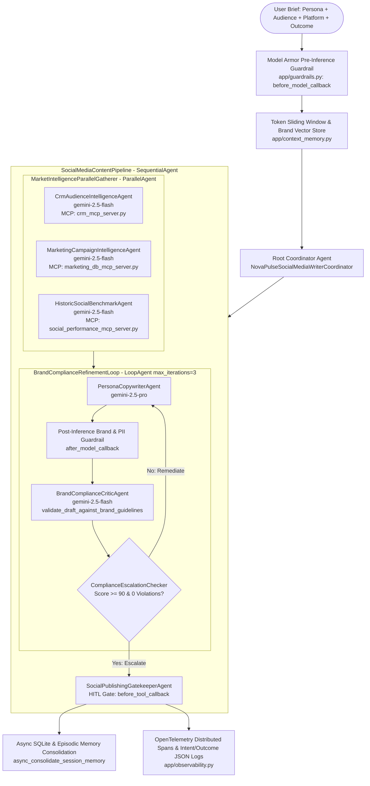

# Technical Design Specification — NovaPulse Enterprise Social Media Writer Agent

> **Disclaimer:** This is a personal educational project and is not an official Google product. All company names (`NovaPulse Cloud Technologies`), products (`PulseGrid`, `PulseShield`, `PulseFlow`), CRM segments, and historical benchmarks are fictional synthetic datasets created for demonstration and evaluation purposes.

---

## 1. Problem Statement & Objectives

### 1.1 Problem Statement
Writing high-converting enterprise social media content is manual, fragmented, and time-intensive. Every post requires careful calibration across four dimensions:
1. **Author Persona** (`founder_ceo`, `chief_architect`, `vp_product_marketing`, `devrel_advocate`)
2. **Target Audience ICP** (`enterprise_cto_vp_eng`, `platform_sre_architects`, `finops_cloud_economics`)
3. **Distribution Platform** (`linkedin`, `x_twitter`, `instagram`, `youtube_community`)
4. **Intended Outcome** (`lead_generation`, `webinar_registration`, `whitepaper_download`, `product_launch`, `developer_adoption`, `thought_leadership`)

Simultaneously, marketing and executive teams must strictly adhere to corporate brand guidelines, avoid prohibited buzzwords or unverified SLA claims, prevent customer PII leakage, and ground every post in verified product proof points and historical social media benchmarks.

### 1.2 Solution Architecture
The **NovaPulse Enterprise Social Media Writer Agent** is a production-grade multi-agent system built on the **Google Agent Development Kit (ADK)** and **Model Context Protocol (MCP)**. It automates the end-to-end social media content engineering lifecycle through:
- **Parallel MCP Context Gathering (`ParallelAgent`)**: Queries three specialized MCP servers concurrently (CRM Audience Intelligence, Marketing Campaign DB, and Historic Social Performance DB).
- **Closed-Loop Brand Compliance Refinement (`LoopAgent` + `ComplianceEscalationChecker`)**: Iteratively drafts (`gemini-2.5-pro`) and critiques (`gemini-2.5-flash`) candidate posts against `novapulse_brand_guidelines.md` until achieving a verified compliance score $\ge 90/100$ with zero critical violations.
- **Human-in-the-Loop (HITL) Publishing Gatekeeper**: Pauses live external social media publication until explicit human confirmation (`human_approval_confirmed=True`) is granted.

---

## 2. Multi-Agent System Architecture

---

## 3. Detailed Mapping to the 5 Engineering Pillars (19 Criteria)

### Pillar 1: Tool & Interface Design
| Criterion | Implementation File & Symbol | Architectural Details |
| :--- | :--- | :--- |
| **1.1 Comprehensive Tool Docstrings** | `app/tools.py` | Every tool includes `WHEN TO USE`, `WHEN NOT TO USE`, typed `Args` with allowed literals, and `Returns` documentation. |
| **1.2 Descriptive Naming** | `app/tools.py` | Action-oriented verb-noun names: `fetch_crm_audience_segment_insights`, `query_marketing_campaign_value_propositions`, `retrieve_historic_social_post_benchmarks`, `validate_draft_against_brand_guidelines`, `publish_approved_social_media_post`. |
| **1.3 Explicit JSON Schemas** | `app/schemas.py` | 10 strict Pydantic v2 models (`CrmAudienceQueryInput`, `BrandComplianceReportOutput`, etc.) with `ConfigDict(extra="forbid")` and `export_all_tool_json_schemas()`. |
| **1.4 Guided Error Handling** | `app/tools.py` | Validation or lookup failures return `status="recoverable_error"` with explicit `llm_recovery_instructions` guiding the LLM on valid enum values and remediation steps. |

### Pillar 2: Context & Memory
| Criterion | Implementation File & Symbol | Architectural Details |
| :--- | :--- | :--- |
| **2.1 Robust System Instructions** | `app/prompts.py` (`AGENT_CONSTITUTION_SYSTEM_PROMPT`) | Comprehensive Agent Constitution defining identity, mandatory workflow protocol, zero-tolerance negative constraints, and output structure. |
| **2.2 History Compaction** | `app/context_memory.py` (`TokenBudgetHistoryCompactor`) & `app/agent.py` (`EventsCompactionConfig`) | Sliding-window token estimator that compacts older turns into metric-preserving executive summaries while keeping recent turns intact. |
| **2.3 Persistent Session State** | `app/context_memory.py` (`PersistentBrandAndSessionStore`) | Durable SQLite persistence (`user_sessions`, `episodic_post_memories`, `brand_guideline_chunks`) with cosine-similarity vector retrieval over `novapulse_brand_guidelines.md`. |
| **2.4 Async Memory Operations** | `app/context_memory.py` (`async_consolidate_session_memory`, `schedule_background_consolidation`) | Runs compaction, PII scrubbing, and SQLite writes asynchronously via `asyncio.create_task` and `asyncio.to_thread` without blocking user responses. |

### Pillar 3: Orchestration & Logic
| Criterion | Implementation File & Symbol | Architectural Details |
| :--- | :--- | :--- |
| **3.1 Multi-Agent Patterns** | `app/agent.py` | Combines `ParallelAgent` (`MarketIntelligenceParallelGatherer`), `LoopAgent` (`BrandComplianceRefinementLoop` + `ComplianceEscalationChecker`), `SequentialAgent` (`SocialMediaContentPipeline`), and root Coordinator `Agent`. |
| **3.2 Strategic Model Routing** | `app/model_router.py` (`StrategicModelRouter`) | Routes deterministic MCP lookups and compliance scoring to `gemini-2.5-flash` (`temperature=0.1`) and creative persona copywriting/remediation to `gemini-2.5-pro`. |
| **3.3 Guardrails & Policy Plugins** | `app/guardrails.py` (`ModelArmorGuardrailPlugin`) | Enforces pre-inference prompt-injection blocking (`inspect_user_prompt`) and post-inference prohibited phrase + PII screening (`inspect_model_output`). |
| **3.4 Human-in-the-Loop Hooks** | `app/guardrails.py` (`HumanInTheLoopApprovalGate`) & `app/tools.py` | Intercepts `publish_approved_social_media_post` via `before_tool_callback`, pausing live publication (`pending_human_confirmation`) until `human_approval_confirmed=True`. |

### Pillar 4: Observability & Tracing
| Criterion | Implementation File & Symbol | Architectural Details |
| :--- | :--- | :--- |
| **4.1 Structured JSON Logging** | `app/observability.py` (`StructuredJsonLogFormatter`, `StructuredAuditLogger`) | Emits single-line Cloud Logging JSON records with `timestamp`, `severity`, `event_type`, `component`, `logging.googleapis.com/trace`, and PII-scrubbed `metadata`. |
| **4.2 Intent vs. Outcome Capture** | `app/observability.py` (`IntentOutcomeAuditTracker`) | Logs `INTENT_DECLARED` before every agent/tool execution and links `OUTCOME_RECORDED` after execution with latency and `matches_intent` verification. |
| **4.3 Distributed Tracing** | `app/observability.py` (`configure_distributed_tracing`, `start_linked_span`) | OpenTelemetry `TracerProvider` linking parent workflow spans to child MCP server, compliance validator, and memory consolidation spans. |
| **4.4 PII Redaction** | `app/observability.py` (`PiiRedactionEngine`) | Active regex + optional Google Cloud DLP (`dlp_v2`) scrubbing pipeline redacting emails, phone numbers, SSNs, credit cards, and API keys before logging or storage. |

### Pillar 5: Infrastructure & CI/CD
| Criterion | Implementation File & Symbol | Architectural Details |
| :--- | :--- | :--- |
| **5.1 Automated Evaluation Suites** | `tests/eval/golden_dataset.json`, `tests/eval/run_evaluation.py`, `tests/eval/eval_config.json` | 7-scenario golden evaluation suite verifying tool trajectories, brand compliance ($\ge 90/100$), loop self-correction, HITL gating, and adversarial prompt blocking. |
| **5.2 Infrastructure as Code (IaC)** | `deployment/terraform/*.tf` & `pyproject.toml` (`[tool.agents-cli]`) | Parameterized Terraform templates provisioning Cloud Run v2, least-privilege IAM, Secret Manager, and BigQuery telemetry sinks. |
| **5.3 Secure Secret Management** | `app/secret_manager.py` (`SecretManagerClient`) & `deployment/terraform/iam.tf` | Retrieves runtime tokens from Google Cloud Secret Manager (`google-cloud-secret-manager`) with zero hardcoded keys in source code. |
